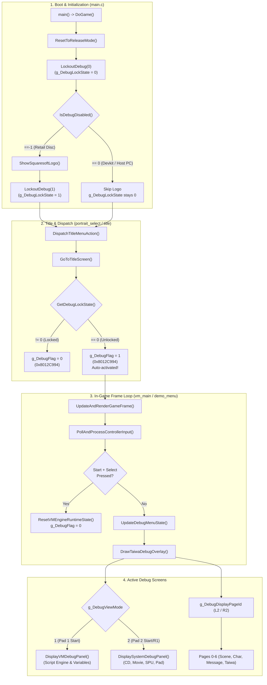

# Another Mind - Debug System Architecture & Reference

This document details the internal debug architecture, control flow, debug screens, function inventory, dummied-out development facilities, and related subsystem function specifications for *Another Mind* (Square, 1998, PlayStation).

---

## 1. Executive Summary & Master Debug Flag

During retail compilation, Square disabled debug mode by hardcoding a master environment check function to return release status (`-1`). However, virtually all debug UI screens, script watchers, memory viewers, and CD/movie diagnostic panels remain fully functional in the final game code.

* **Master RAM Flag Address**: `0x8012C994` (`g_DebugFlag`)
  * `0`: Normal retail game execution.
  * `1`: Debug mode active (enables debug HUD, debug overlays, screen pagers, and controller shortcuts).
* **Debug Lockout Flag**: `0x80061FEC` (`g_DebugLockState`)
  * `0`: Debug allowed.
  * `1`: Debug locked out.

---

## 2. Debug Execution Flow



### Detailed Flow Explanation:
1. **Cold Boot (`ResetToReleaseMode`)**:
   `LockoutDebug(0)` clears the lock. The game checks `IsDebugDisabled()`. In retail builds, this function was hardcoded to return `-1`, which displays the Squaresoft copyright logo and sets `LockoutDebug(1)`.
2. **Title Menu Action (`DispatchTitleMenuAction`)**:
   Calls `GetDebugLockState()`. If unlocked (`0`), it sets `g_DebugFlag = 1`. In original development environments (where `IsDebugDisabled()` returned `0`), simply booting the game automatically engaged debug mode.
3. **Runtime Pad Polling (`PollAndProcessControllerInput`)**:
   When `g_DebugFlag == 1`, pressing **Start + Select** (`0x0900`) immediately breaks to the title screen and clears `g_DebugFlag = 0`.
4. **Debug Menu Router (`UpdateDebugMenuState` & `DrawTaiwaDebugOverlay`)**:
   If `g_DebugFlag == 1`, the controller input router enables debug buttons to switch modes and cycle pages.

---

## 3. Debug Controls & Keybindings

### Controller 1:
| Button Combination | Action | Notes |
|---|---|---|
| **Start** | Toggle CPU Meter & Main Script Debug Menu | Toggles `g_DebugViewMode = 1` |
| **Start + Select** | Exit to Title Screen & Turn Off Debug | Clears `g_DebugFlag = 0` via `ResetVMEngineRuntimeState` |
| **L1 / R1** | Change Background Graphic (BG File) | Page 1 |
| **L2 / R2** | Cycle Debug Screens (Pages 0 – 6) | Increments/decrements `g_DebugDisplayPageId` |
| **D-Pad Left / Right** | Select Active Digit / Field | In Character, Message, and Memory viewers |
| **D-Pad Up / Down** | Increment / Decrement Selected Value | Adjusts indices, coordinates, or flags |
| **Cross ($\times$) + D-Pad** | Fast Move / Translate Sprite Position | Moves character/window origin $(X, Y)$ |
| **Cross ($\times$)** | Confirm Selection / Load Asset | Loads chosen character file or scenario |
| **Triangle ($\triangle$)** | Increase Animation Playback Speed | Steps up character sprite playback rate |
| **Circle ($\bigcirc$)** | Decrease Animation Playback Speed | Steps down character sprite playback rate |

### Controller 2:
| Button Combination | Action | Notes |
|---|---|---|
| **Start** or **R1** | Toggle Hardware / System Debug Panel | Toggles `g_DebugViewMode = 2` |
| **L2** (Bit `0x0004`) | Development Video/Streaming Hook | Calls `DebugOnController2L2Press()` |

---

## 4. Debug Header Line Specification (`debugheadernote`)

Across the top of the debug screens, the engine renders a real-time system status line via `DrawTaiwaDebugOverlay` and `DisplayVMDebugPanel`:

```text
spcno 0007/0075  mc.0000/0000  sss  srl.flag: 0000  srl.show: 0001  srl.file: 0100 / 16BIT
```

| Field Label | Example | Source Variable / Function | Meaning |
|---|---|---|---|
| **`spcno`** | `0007/0075` | `g_DebugDrawPrimitiveIndex` / Max `0x4B` (75) | **Screen Primitive Count**: Active ordering-table primitive packets used vs. maximum hardware allocation (75). |
| **`mc.`** | `0000/0000` | `LoadMemoryCardSaveHeaders()` | **Memory Card Status**: Available save headers / valid game slots detected on Memory Card. |
| **`sss`** | `sss` | `g_Sss` (`0x8012C97C`) | **System Sub-State**: VM engine internal execution sub-state (normally `0`). |
| **`srl.flag`** | `0000` | `g_ScriptFlag` (`0x80130D10`) | **Active Scenario Script Flag**: Current branch condition/state flag within the scenario script. |
| **`srl.show`** | `0001` | `g_ScriptShowFlag` (`0x80130D12`) | **Script Display Visibility State**: Controls whether script elements/layers are currently visible. |
| **`srl.file`** | `0100` | `g_ValidFunctionArgument` / `scriptFileId` | **Loaded Script Asset ID**: Numeric identifier of the currently loaded scenario script block. |
| **Mode** | `/ 8BIT` or `/ 16BIT` | `s_Debug8BitMode` / `s_Debug16BitMode` | **Color / Data Depth Mode**: Current frame buffer render depth mode. |

---

## 5. Debug Screen Pages Reference (`debugnotes`)

When `g_DebugDisplayPageId` is cycled using **L2 / R2**, the display changes between 7 main pages:

### Page 0: MAIN MENU (Script Engine & Memory Inspector)
Triggered with **Pad 1 Start**. Managed by `DisplayVMDebugPanel` and `DoDebugOptionMenu`:
* **`OK`**: Exit debug menu and return to gameplay.
* **`BASICS* SYSTEM`**: Toggles between scenario execution metrics (`PrintScriptBasicDebug`) and engine memory pointer metrics (`PrintScriptSystemDebug`).
  * `PTR`: Script absolute memory address.
  * `S ADDR`: Base address where current script block was loaded.
  * `S OFFS`: Offset of execution pointer within script block.
  * `*VPRE.PTR`: Preloaded opcode command about to execute next.
* **`STEP`**: Single-step VM bytecode opcode execution frame by frame.
* **`LABEL`**: Displays current active script label (`SetActiveScriptLabel`, `RecordCallLabel`).
* **`WATCH`**: Toggles real-time variable watch window on screen (`DrawWatchDebugValues`).
* **`WATCH16: HEX* BINARY`**: Displays 16-bit registers/variables in hexadecimal or binary (`DrawWatch16ValuesHex`, `DrawWatch16ValuesBinary`).
* **`WATCHFLAG`**: Displays bitfield table of watched engine and story flags (`DrawWatchedScriptFlags`).
* **`CODE: 0000`**: Shows rolling execution log of script opcode instructions executed (`DrawScriptExecutionLog`, `LogCommand`).
* **`TAIWA` (対話; Dialogue)**: Displays dialogue system parameters (`ShowTaiwaDebugData`).
* **`MSPEED0`**: Forces message typewriter display speed to maximum (fastest).
* **`FLAG* GLOBAL`**: Full memory inspector for local script flags vs. global engine memory (`DrawFlagInspectorList`, `DrawGlobalInspectorList`).

### Page 1: SCREEN SCRIPT (Background Inspector)
* Displays `SCENE SCRIPT` header and `BG FILE [ID]`.
* Allows cycling through all background image files loaded from the game disc or dev drive using **L1 / R1**.
* Displays bit depth (`/ 8BIT` or `/ 16BIT`).

### Page 2: CHR FILE 0 (Character Sprite Viewer - Slot 0)
* Displays `CHR FILE 0` with current character asset index (0–810).
* Shows origin coordinates: `XY = [0-319], [0-207]`.
* Shows sprite dimensions: `SIZE = [W],[H]` (in 16px tile blocks, up to 64x64px).
* Shows animation state: `speed=[N] / NORMAL` or `/ NEXT` (indicates whether current animation loops or chains into another character ID).
* Controls: **D-Pad** changes digit/number, **$\times$ + D-Pad** repositions sprite, **$\triangle$ / $\bigcirc$** adjusts animation speed.

### Page 3: CHR 0 MESSAGE (Character 0 Text Box Inspector)
* Displays `CHR 0 MESSAGE`.
* Renders a bounding box highlighting the dialogue message area.
* Shows message box origin coordinates: `XY = [0-319], [0-207]`.
* Allows repositioning message layout coordinates on screen.

### Page 4: (BLANK / RESERVED)
* Unused / clear screen buffer slot.

### Page 5: CHR FILE 1 & CHR 2 MESSAGE (Character Slot 1 Inspector)
* Inspects secondary character sprite slot and secondary dialogue message placement.
* If character slot 1 is inactive, window movement is locked.

### Page 6: TAIWA (Natural Language & Choice Engine Inspector)
* **`LIMIT`**: Number of available player interaction choices in current branch.
* **`MMAX`**: Maximum character width permissible for the message.
* **`JN`**: Unconjugated Japanese verb / noun root last evaluated.
* **`JV`**: Japanese verb conjugation pattern last selected.
* **`SLOT`**: Active keyword slot assignment.
* **`TN[2]` / `KN[2]`**: Topic noun and keyword noun match registers.

### Hardware / System Debug Panel (Pad 2 Start)
Managed by `DisplaySystemDebugPanel`:
* **CD Control & Transfer Status**: Displays sector read positions, seek status, sector count, and transfer buffer status (`DisplayCdControlStatusToDebugScreen`, `DisplayCdFileDebugStatus`).
* **Movie Decoder Panel**: Displays MDEC video playback status, ring buffer frame read status, and current movie frame number (`DisplayMovieDebugPanel`).
* **Controller Diagnostic Panel**: Raw button bitmasks, analog axes, and vibration motor actuators (`DisplayPadDebugPanel`).

---

## 6. Dummied-Out Functions Analysis

| Function Symbol | Location | Status | Purpose & Behavior |
|---|---|---|---|
| `IsDebugDisabled` | `src/main/cd_stream.c:48` | Hardcoded `return -1;` | **Development Host Environment Check**.<br>Returned `0` in dev builds, enabling `PCinit()`, skipping publisher logo, and unlocking `g_DebugLockState`. Returning `-1` forces retail security lock. |
| `LoadScriptByFilename` | `src/main/cd_stream.c:50` | Hardcoded `return 0;` | **PC Host File Loader (`PCReadFile` / `LoadFileFromPC`)**.<br>Attempts to load `"boot.zzz"` (or script assets) from host workstation over DTL-H2000 link into `0x80138000`. Returns `0` to force fallback to CD-ROM `LoadByFileIdGroupId`. |
| `PCinit` | `src/main/psxsdk.c:522` | `break 0, 257` | **Psy-Q Development Breakpoint Trap**.<br>Hardware break instruction used by Sony SN-Systems debugger. In retail, never reached because `IsDebugDisabled()` returns `-1`. |
| `DebugOnController2L2Press` | `src/main/cd_stream.c:78` | Empty `{}` | **Movie Playback / CD Stream Debug Hook**.<br>Called by `UpdateVibrationAndInput` when player 2 presses button bit `0x4`. Dummied out in master; used in dev builds to pause or skip video cutscenes. |
| `DbgPrintDebugStringTest` | `src/main/cd_stream.c:70` | Prints debug strings | **Debug Print Verification**.<br>Diagnostic print routine that emits `"Debug String:\nDebugString\n"` via `DbgScreenPrintString`. |
| `StubStopXAPlayback` | `src/main/cd_stream.c:114` | Empty `{}` | **XA Stream Stop Callback**.<br>Psy-Q audio streaming stop hook in `StUnSetRing`. |
| `StubResetStreamRing` | `src/main/cd_stream.c:116` | Empty `{}` | **Stream Ring Buffer Reset Callback**.<br>Psy-Q streaming teardown hook in `StUnSetRing`. |
| `StubPortraitCallback1` | `src/vm_engine/vm_main.c:147` | Empty `{}` | **UI State Transition NOP**.<br>Default empty action handler in jump table `FD390.data.s`. |
| `StubPortraitCallback2` | `src/vm_engine/vm_main.c:153` | Empty `{}` | **UI State Transition NOP**.<br>Default empty action handler in jump table `FD390.data.s`. |

---

## 7. Engine Subsystem Function Directory

### A. Dialogue & UI Subsystem (`vm_engine`)

| Address | Function Symbol | Subsystem Purpose & Behavior |
|---|---|---|
| `0x800F73AC` | `ProcessTaiwaStateMachine` | Master dialogue and choice interaction state machine evaluated every frame. Handles choice selection logic, and executes debug hooks if `g_DebugFlag == 1`. |
| `0x800F61D8` | `CalcTaiwaWordSlotLayout` | Scans `g_PortraitGroupTable` for phrase entries and computes character width bounds against `g_TaiwaMmax` and character spacing. |
| `0x800F6454` | `PositionTaiwaSelectionCursor` | Multiplies spacing by active selection index to position the selection cursor bar (`g_TaiwaBarX`) and bounding rectangles. |
| `0x800F6704` | `ApplyTaiwaSpriteTintAndOffsets` | Applies default 0x80 RGB tint components (`g_DefaultTintR/G/BComponent`) and coordinate offsets for option sprites. |
| `0x800F694C` | `UpdateTaiwaChoiceEntry` | Updates dialogue choice selection slots and resets tint registers. |
| `0x800F6D04` | `ParseTaiwaSentenceAndConjugation` | Evaluates dialogue inputs using `LookupVerbConjugation`, `ParseTaiwaSentenceStructure`, and `ValidateTaiwaPhraseLength`. Part of the Japanese NLP parser. |
| `0x800F6E7C` | `CalcTaiwaChoiceYPositions` | Calculates vertical layout offset $(Y = \text{spacing} \times \text{lines})$ for option rows in choice boxes. |
| `0x800F6B38` | `FreePortraitTileSlot` | Iterates through `g_PortraitSlotTileTable` (0x14A entries) and clears tiles assigned to the specified index. |
| `0x80109064` | `ResetVMEngineRuntimeState` | Clears all VM engine runtime variables (repeat delay, frame counters, `g_DebugDisplayPageId`, `g_DebugViewMode`, `g_DebugFlag`, `g_TaiwaActive`, sprites). |

---

### B. Scenario Script Interpreter Subsystem (`script`)

| Address | Function Symbol | Subsystem Purpose & Behavior |
|---|---|---|
| `0x8001CA18` | `ResetScriptInterpreterState` | Resets scenario script interpreter state, audio channels, and attempts devkit `PCinit()`. |
| `0x80025CCC` | `Cmd_getnews` | Opcode handler for `getnews` (primary variant for news/keyword acquisition). |
| `0x80029820` | `Cmd_news` | Opcode handler for `getnews` (secondary variant checking inventory slots). |

---

### C. Name Entry & Input Subsystem (`name_entry`)

| Address | Function Symbol | Subsystem Purpose & Behavior |
|---|---|---|
| `0x80014F5C` | `GetHeroEnteredNameLength` | Scans protagonist name entry buffer for first null/terminator byte and returns string length. |
| `0x800158E8` | `GetHeroineEnteredNameLength` | Scans heroine ("Hitomi") name entry buffer and returns string length. |
| `0x80015E70` | `ApplyControllerVibrationDirect` | Applies vibration motor actuator parameters directly to controller dual-shock buffers. |

---

### D. Movie & CD Streaming Subsystem (`cd_stream`)

| Address | Function Symbol | Subsystem Purpose & Behavior |
|---|---|---|
| `0x8001A124` | `DbgPrintDebugStringTest` | Emits `"Debug String:"` and `"DebugString"` to debug text screen buffer. |
| `0x8001B9D0` | `PlayDefaultMovieStream` | Starts playback of a default movie cutscene segment by stream channel ID. |
| `0x8001BA64` | `PlayMovieStreamWithOffset` | Plays movie cutscene with start frame offset override or falls back to segment index. |
| `0x8001BAC0` | `PlayMovieStreamLooping` | Configures MDEC stream decoder for continuous looping playback of movie ID. |
| `0x8001BB00` | `AbortAndShutdownMovieDecoder` | Aborts active video DMA transfer and shuts down MDEC decoder. |
| `0x8001BCE8` | `ClearMovieDecoderActiveFlag` | Clears internal movie decoder active flag (`g_MovieDecoderActive = 0`). |

---

### E. Sound Engine Subsystem (`akao`)

| Address | Function Symbol | Subsystem Purpose & Behavior |
|---|---|---|
| `0x8002DFB4` | `AkaoPlaySoundEffectDefault` | Triggers sound effect on SPU voice channel with default volume and pan. |
| `0x8002E5F0` | `AkaoPlaySoundEffectWithPan` | Triggers sound effect with explicit volume attenuation and pan balance. |
| `0x8002E690` | `AkaoPlayMusicSequence` | Initiates sequence playback for music track ID through AKAO sequence engine. |
| `0x8002EBC8` | `AkaoPlayMusicSequenceWithFade` | Queues and starts secondary music sequence stream with fade parameters. |
| `0x80033B38` | `AkaoOp_NOP_80033B38` | Empty callback handler in AKAO sound driver command table. |
| `0x80034134` | `AkaoOp_NOP_80034134` | Empty voice channel parameter update callback in AKAO sound driver. |

---

## 8. Master Inventory of True Debug Functions

Below is the verified inventory of authentic debug routines remaining in the binary:

### Engine & Screen Management
* `DrawTaiwaDebugOverlay`: Master renderer for the debug text buffer, header line, and page router.
* `DisplayVMDebugPanel`: Renders Page 0 Main Menu and formats the top `spcno / mc. / srl` header.
* `UpdateDebugMenuState`: Processes controller input when `g_DebugFlag == 1` to change pages (L2/R2) and backgrounds (L1/R1).
* `DrawPortraitSlotDebug`: Renders character debug info (`CHR FILE %d`, `XY = %d,%d`, `SIZE=%d,%d`, `speed=%d / NORMAL / NEXT`).
* `DrawFaceSlotBoxDebug`: Renders text box bounding borders (`CHR %d MESSAGE`).
* `DrawDebugHorizontalCursorMarker`: Draws interactive horizontal selection line marker.
* `Load8x8DebugFont`: Loads PlayStation 8x8 ASCII debug font textures into VRAM.
* `DbgScreenPrintString` / `DbgScreenPrintInt` / `DbgScreenPrintBinary`: Low-level ASCII print formatters into the debug overlay buffer.

### Script & Variable Debuggers
* `SetupDebugOptionMenu` / `DoDebugOptionMenu`: Interactive menu loop for the Page 0 VM debugger.
* `PrintScriptBasicDebug`: Prints scenario label, frame timing, and VM thread state.
* `PrintScriptSystemDebug`: Prints script pointer (`PTR`), base load address (`S ADDR`), and current offset (`S OFFS`).
* `DrawWatchedScriptFlags`: Formats active scenario flags in memory.
* `DrawWatchDebugValues`: Formats watched memory addresses into the watch window.
* `DrawWatch16ValuesHex` / `DrawWatch16ValuesBinary`: Displays 16-bit register words in hexadecimal or binary format.
* `DrawFlagInspectorList` / `DrawGlobalInspectorList`: Memory viewer for local vs. global game variables.
* `DrawScriptExecutionLog`: Rolling execution log of recent bytecode instructions.
* `LogCommand` / `LogArgumentString`: Bytecode logger hooks.
* `SetActiveScriptLabel` / `RecordCallLabel`: Call-stack tracker for script function jumps and calls.
* `ShowTaiwaDebugData`: Displays natural language engine runtime variables (`LIMIT`, `MMAX`, `JN`, `JV`).

### System & Hardware Diagnostics
* `DisplaySystemDebugPanel`: Master diagnostic panel for CD, Movie, and Pad.
* `DisplayCdControlStatusToDebugScreen`: Real-time CD-ROM drive seek/read sector telemetry.
* `DisplayCdFileDebugStatus`: File sector allocation and buffer state.
* `DisplayMovieDebugPanel`: STR/MDEC streaming decoder metrics and frame drops.
* `DisplayPadDebugPanel`: Real-time button bitmasks and vibration actuators.
* `GetDebugScriptBuildDateString`: Decodes and formats compilation timestamp into `YY/MM/DD HH:MM:SS`.
